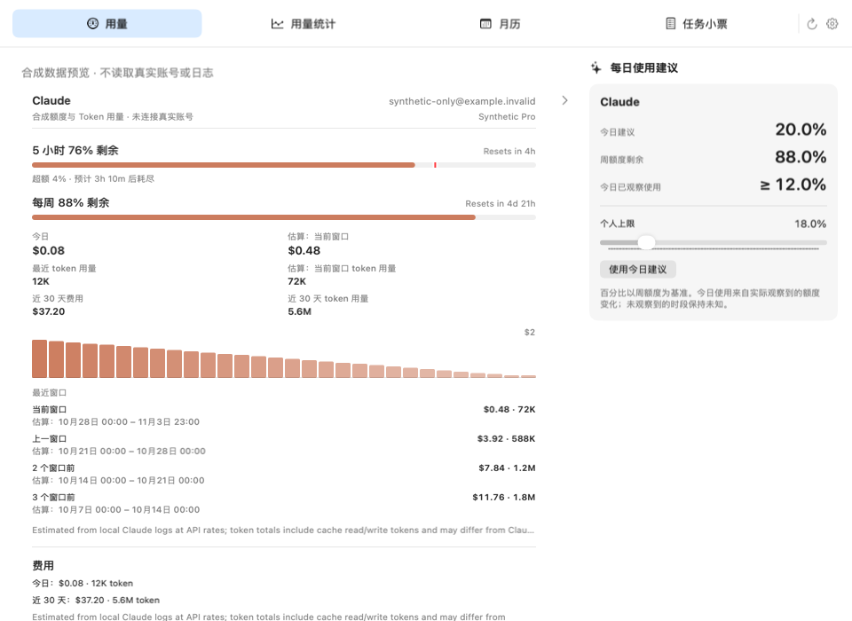
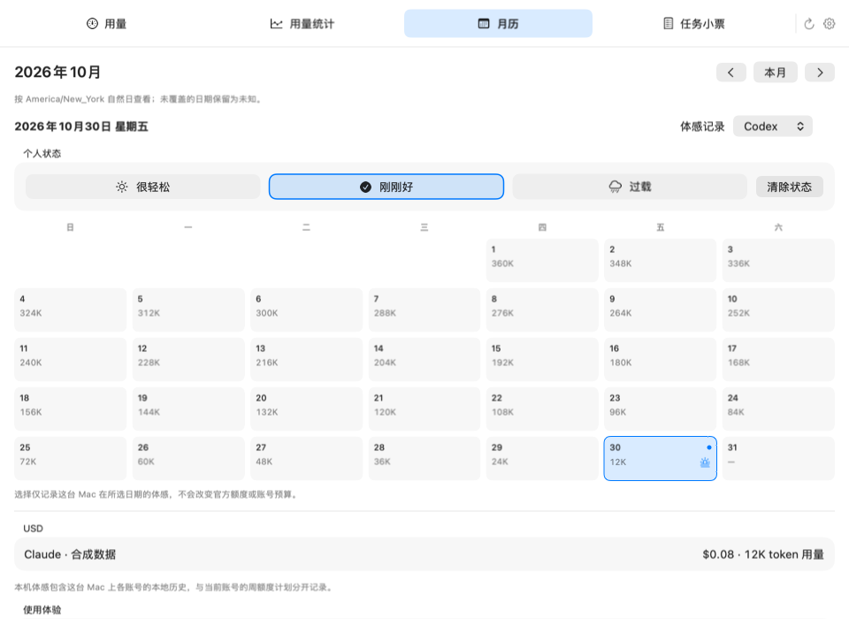
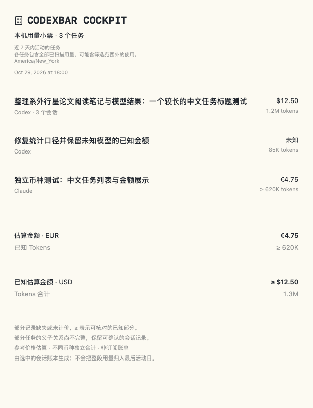

# CodexBar Cockpit

A native macOS menu-bar home for AI usage, daily planning, and task receipts.

CodexBar Cockpit combines [CodexBar](https://github.com/steipete/CodexBar)'s native menu bar and
provider support with local planning and task workflows inspired by
[Codex Cockpit](https://github.com/HouSiyuan2001/codex-cockpit). It is an independent community project.

**Development status:** pre-release integration under active validation. No signed public binary is available yet.

## 设计目标

- 保留 CodexBar 的全部提供商及菜单栏呈现。
- 点击菜单栏图标，在同一面板切换用量、统计、日历和小票；每日建议直接出现在用量页。
- 宽屏用量页采用双栏：左侧保留完整提供商卡片和操作，右侧显示每日建议与个人上限；小屏自动切回单栏。
- 复用现有统计账本，提供用量图表、月历、模型和项目统计。
- 以本地自然日保存预算和体感记录；额度、Token 和估算金额各有明确口径。
- 勾选任务生成 PNG 小票；父子 Agent 合并时避免重复计算。
- 开发版使用独立设置与缓存，在“设置 → 通用”主动导入原 CodexBar 的主要显示设置。

当前实现与未完成验收见 [开发清单](docs/cockpit/ROADMAP.md)，已完成检查见 [验证记录](docs/cockpit/VALIDATION.md)。

## Preview

Native SwiftUI/AppKit rendering with synthetic data; these are not personal usage records.



[Compact single-column fallback](docs/cockpit/images/unified-usage-compact-zh.png)





## Build

Requires macOS, full Xcode with Swift 6.2 or later, and the dependencies pinned in `Package.resolved`.
The initial baseline was compiled with Xcode 27 / Swift 6.4 on Apple Silicon.

```sh
swift build --product CodexBar
make test-fast FILTER='Cockpit'
make check
./Scripts/package_cockpit.sh debug
```

The bundle is `CodexBar Cockpit.app`. Click the status icon and switch pages in the same panel.
An independent application identity and data directory
allow testing alongside the original app. The full upstream test suite can be run with
`./Scripts/test.sh --direct-workers 8`.

## Data and privacy

App-owned files live in `~/.config/codexbar-cockpit` and
`~/Library/Application Support/CodexBar Cockpit`. Provider logs and login sessions remain local inputs.
Missing values stay unknown; prices are estimates and quota observations can have incomplete coverage.
Budget plans apply to supported fixed weekly quota windows and never infer official quota from dollar costs.

Cloud sharing from Cockpit is outside the initial scope. Existing upstream capabilities are preserved;
using them requires their own configuration. Public repositories contain source and synthetic fixtures,
not personal logs, tokens, settings, or usage exports.

## Contributing and provenance

Read [architecture](docs/cockpit/ARCHITECTURE.md), [contribution notes](CONTRIBUTING.md),
and [upstream pins](UPSTREAM.md). The original CodexBar documentation remains available as
[README.upstream.md](README.upstream.md); its release links describe upstream, not this fork.

MIT licensed. Copyright notices for Peter Steinberger, Quota Float contributors, and this project's
contributors are retained in [LICENSE](LICENSE) and [licenses](licenses).
